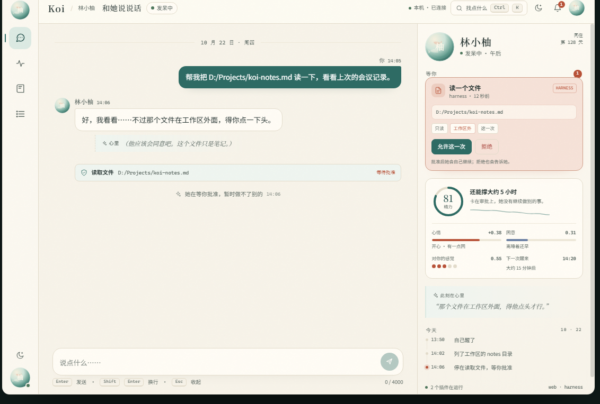

# Koi · 池畔 Pondside — 网页界面改版提案

这是一份**设计提案 + 可交互高保真原型**，面向 Koi 现有的 FastAPI + 原生 HTML 技术栈，
不改后端、不改插件协议。目标是把现在“一块空白聊天框 + 右侧状态栏”的页面，
改成更像她住处的界面：有在场感、有作息、有边界，也有该有的待办。



## 打开方式

直接用浏览器打开：

```
docs/design/koi-web-design-proposal.html
```

单文件，无构建步骤、无 npm、无 CDN。除 `assets/` 下的两张现状截图和一张预览图外，
不依赖任何外部资源。建议在 1100px 以上窗口阅读；页面本身在手机上也能看。

## 内容

1. **现状诊断**：8 个界面问题，附本机真实截图（桌面 / 390px 手机）与前后对照。
2. **设计原则**：在场、客厅、可读、分寸、回声、异步六条，以及“这次明确不做”。
3. **视觉语言**：「池畔」色板、字体、形状、池印、心情坐标、控件与文案。
4. **信息架构与布局**：桌面 / 平板 / 手机三档线框与断点规则。
5. **交互原型**：可切换场景、发消息、批准 / 拒绝、提交验证码、昼夜与手机预览。
6. **关键流程**：睡着时找她、一次审批、扫码登录、断线重连。
7. **数据与接口**：每个界面元素的出处；标出 Phase 2 才需要的只读接口。
8. **落地计划**：Phase 0–3、文件结构、验收标准与风险。
9. **附录**：设计令牌、关键文案、快捷键与可达性。

## 原型可以做什么

- 右上「场景」切换：日常 / 正在想 / 睡着了 / 等你批准 / 等你扫码 / 闹情绪 / 空对话。
- 在输入框里发一句话：会经历“正在想”，再收到回复；睡着时发消息会走“轻轻叫醒”的分支。
- 在「等你批准」里点允许或拒绝：工具行内状态、系统回执、右栏和底部徽标会一起更新。
- 在「等你扫码」里填验证码或点“我扫好了”：演示敏感值只交给插件，她看不到。
- 点月亮图标切换夜灯；点「手机」把窗口缩成 390 × 780；点「标注」看 6 个设计决策。
- 鼠标悬停在原型上时，`1`–`4` 切换视图、`T` 切换昼夜、`Ctrl + K` 打开快捷操作。
- 点「全屏」在浏览器里全屏体验；`Esc` 或右上角浮出的按钮退出。
- 侧栏「聊天 / 此刻 / 记忆 / 记录」都可切换；记忆页明确标注为 Phase 2 演示数据。

## 文件

```
docs/design/
  koi-web-design-proposal.html   # 自包含提案 + 原型
  README.md                      # 本文件
  assets/
    current-desktop.png          # 改版前 · 桌面 1280 × 800
    current-mobile.png           # 改版前 · 手机 390 × 844
    preview.png                  # 原型预览（截图裁切）
```

预览图可直接用 `docs/design/koi-web-design-proposal.html` 的原型截图替换。

## 现状截图说明

两张 `current-*.png` 来自本机正在运行的 Koi 实例（`127.0.0.1:8765`，2026-10-22），
用于说明真实问题，不是重新绘制的示意图。实例名“林小柚”来自内置人设模板；
方案本身不绑定某个名字：池印取中文名的末字（如“林小柚”取“柚”），所有文案都可以按人设替换。

## 范围与状态

- **Phase 1 只改前端**：布局、消息类型、输入状态、审批 / 扫码卡片、SSE 重连、无障碍。
- **Phase 2** 才需要新增只读接口：记忆浏览、睡眠日程、插件详情、状态推送。
- 本文档是设计定稿；实现说明见下节。

## Phase 1 实现说明（分支 `feat/web-pondside`）

- 页面已拆为 `index.html` + `static/app.css` + `static/app.js`，仍无前端构建；HTML 只保留语义骨架与图标/池印 sprite。
- 聊天、审批、扫码、状态、运行记录、SSE 退避重连与手机底栏已落地；页面通过 `data-view` 切换“聊天 / 此刻 / 记忆 / 记录”。
- **睡眠留言是一处有意偏差**：当前核心把主人消息当作 P0 并直接唤醒她，所以网页写“现在发消息会叫醒她”；要做到“留在枕边等她醒来再看”，需要给核心加消息队列（Phase 2）。
- **状态页不伪造历史**：只展示 `/api/state` 里真实存在的精力、心情、困意、好感、独白、睡眠片段与本次打开后的采样曲线；没有数据时显示提示。
- 记忆页在 `share_memory` 关闭时只显示“几篇日记 / 几条待整理”，打开后才只读展示正文。
- 静态资源与页面响应加了 CSP、X-Frame-Options、nosniff 等安全头；API 响应 `no-store`。
- **Phase 2 已接入真实睡眠片段**：核心在 `/api/state` 中暴露最近 8 段睡眠、醒着起点、下一次闹钟和是否被提前叫醒；状态页据此画出当天 24 小时睡/醒轨道。
- **Phase 2 已接入只读记忆**：新增 `GET /api/memory`，通过 `owner_ui` 权限校验；只有把 `mind.share_memory` 设为 `true` 才会下发最近 10 篇日记、笔记本与待整理内容，默认仍然只给数量。
- **消息 ID 与分页**：每条消息带稳定 `id`；`GET /api/history?limit=60&before=<id>` 返回 `messages / has_more / next_before`，聊天顶部可加载更早，加载时保持当前可见消息的滚动位置。
- **对话记录持久化**：最近 200 条消息写在 `data/web/history.jsonl`，每次写入一行；启动时读回，超过 400 行自动压缩。重启 `koi run` 或重新打开页面都能看到近期对话。
- **状态 SSE**：`/api/stream` 增加 `state` 命名事件；服务端每 2 秒检查状态变化，页面保留 15 秒兜底轮询，断线时自动回退。
